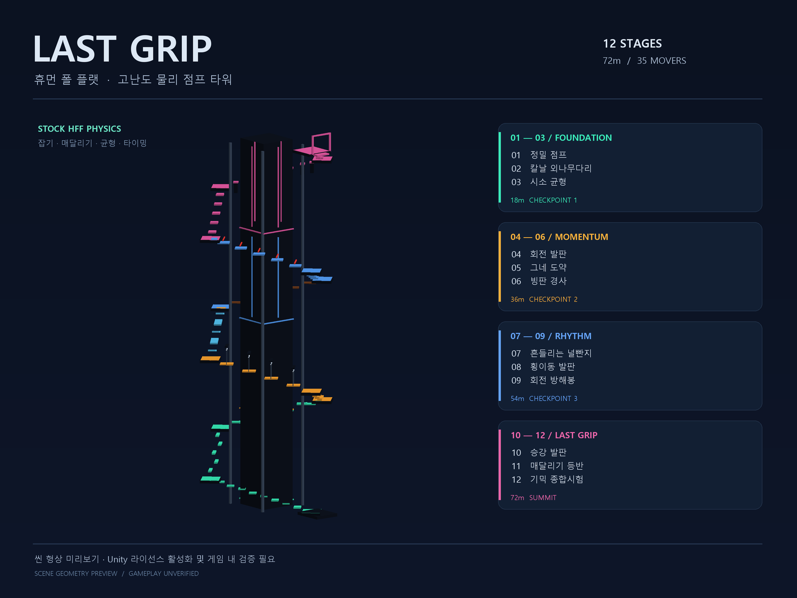

# 나래 유니티 · Narae Unity

Windows용 프로젝트 관리 도구와 Human: Fall Flat 예제 맵 전용 독립 exporter입니다. Unity 전체 기능의 복제본이나 라이선스 해제 프로그램은 아닙니다.



## 다운로드

[Releases](https://github.com/y5496694/narae-unity/releases/tag/v0.2.0)에서 Windows 배포본을 받아 압축을 풉니다. `NaraeUnity/App/NaraeUnity.exe`를 실행하세요. App 폴더의 동반 DLL을 함께 보관해야 합니다.

앱은 .NET 런타임을 포함합니다. 독립 맵 내보내기에는 Python 3과 아래 의존성이 필요합니다.

```powershell
python -m pip install -r .\LastGripTower\Tools\IndependentExporter\requirements.txt
```

## 기능

- 씬 형상·구간·체크포인트 및 검증 정보 보기
- 에디터 없이 지원되는 LAST GRIP 씬을 게임용 번들로 내보내기
- 출력 해시·구조 검사, 실행 로그와 취소
- 설치된 정식 Unity 에디터 열기 및 Unity 검사·렌더 명령 연결

독립 Export는 정식 에디터를 실행하지 않습니다. Unity Validate·Render는 설치된 에디터와 유효한 라이선스가 필요합니다. 형식이 다른 Unity 프로젝트와 임의의 사용자 스크립트를 모두 지원하는 일반 목적 exporter는 아닙니다.

## 소스에서 빌드

Windows와 .NET 8 SDK가 필요합니다.

```powershell
.\Tools\build.ps1
.\Tools\test.ps1
python -m pip install -r .\examples\LastGripTower\Tools\IndependentExporter\requirements.txt
.\dist\NaraeUnity\App\NaraeUnity.exe --action export | Out-String
```

배포 레이아웃은 `dist/NaraeUnity/App`와 그 옆의 `dist/LastGripTower`입니다. 생성된 맵은 `dist/LastGripTower/Build/LastGrip`에 저장됩니다.

```powershell
.\dist\NaraeUnity\App\NaraeUnity.exe --help | Out-String
.\dist\NaraeUnity\App\NaraeUnity.exe --action export --project '<프로젝트 경로>' | Out-String
```

전체 에디터로 원본 `.unity` 씬을 편집하려면 게임의 공식 Workshop SDK를 가져와야 합니다. 게임·Unity 실행 파일과 공식 SDK DLL은 저장소에 포함하지 않습니다.

## LAST GRIP 예제

12구간·72m 물리 타워이며 3구간마다 체크포인트를 둡니다. 회전·시소·그네·빙판·궤도 이동·회전 승강 발판을 포함합니다. 생성된 폴더의 `data`, `metadata.json`, `thumbnail.png`를 아래 새 폴더에 복사한 뒤 게임의 로컬 레벨에서 선택합니다.

```text
%USERPROFILE%\AppData\LocalLow\NoBrakesGames\Human\Workshop\Levels\Narae_LastGrip
```

## 검증 범위

앱 자체 검사23개가 통과했고, 에디터가 없는 경로를 지정한 실제 Export도 성공했습니다. 예제의 데이터 SHA256은 [네이티브 검증 기록](Docs/native-validation.json)에 있습니다.

격리된 Unity 2017.4.13f1 런타임에서 전체 씬 로드, 누락 스크립트0, 물리 바디40개·힌지40개, 체크포인트4곳의 바닥과 물리200스텝을 확인했습니다. 테스트 런타임에서는 게임 콜백을 중지했습니다. 실제 완주·멀티플레이는 검증하지 않았습니다.

## 구성

- `Source/`: C# WinForms 앱
- `examples/LastGripTower/`: 직접 작성한 예제와 독립 exporter
- `Tools/`: 로컬 빌드·검사·패키징
- `Docs/`: 경로 정보를 정리한 분석 요약·검증 결과

[REA](https://github.com/morluto/rea)로 설치된 Unity와 HFF 관리 코드의 내보내기 경로를 분석했습니다. 독립 serializer는 원본 객체 테이블을 새로 작성하고 작은 연속 ID와 게임 기본 리소스 참조를 사용합니다. 예제의 배치·재질은 직접 작성했으며 다른 맵의 배치·텍스처·오디오를 포함하지 않습니다. Unity와 게임 실행 파일·라이선스를 변경하지 않습니다.
